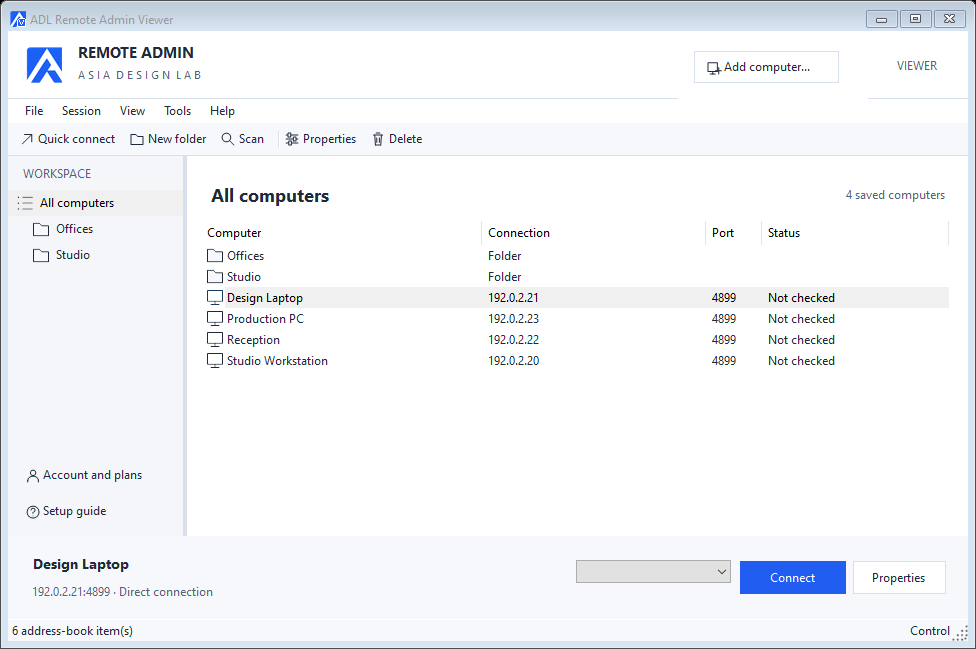
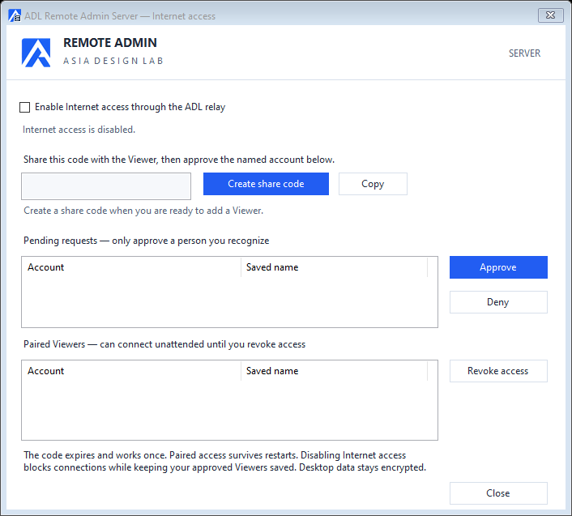
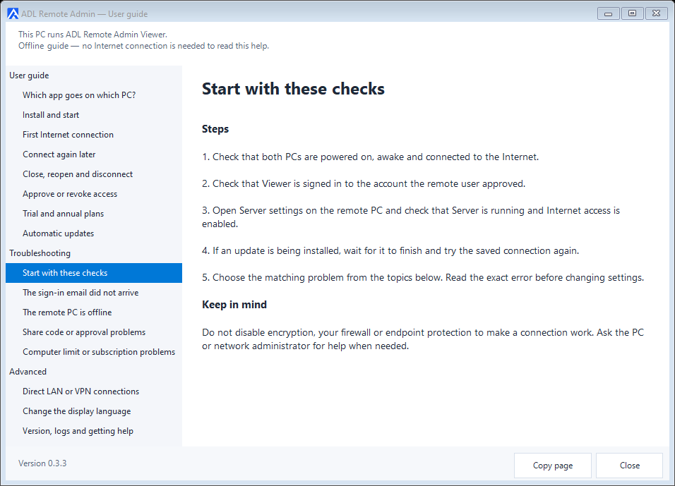

# ADL Remote Admin

**An AnyDesk and TeamViewer alternative for Windows.** ADL Remote Admin is a better fit when you want share-code pairing, a saved list of approved PCs, and the ability to revoke access on the remote computer. Built by **ASIA DESIGN LAB**.

**[Download Viewer](https://github.com/AsiaDesignLab/adl-remote-admin/releases/download/v0.3.9/ADL-Remote-Admin-Viewer-0.3.9-win-x64.msi)** · **[Download Server](https://github.com/AsiaDesignLab/adl-remote-admin/releases/download/v0.3.9/ADL-Remote-Admin-Server-0.3.9-win-x64.msi)** · [Release and checksums](https://github.com/AsiaDesignLab/adl-remote-admin/releases/tag/v0.3.9)

## Install the right app on each PC

| Use on | Installer | What it does |
| --- | --- | --- |
| The Windows PC you are **connecting from** | [Viewer](https://github.com/AsiaDesignLab/adl-remote-admin/releases/download/v0.3.9/ADL-Remote-Admin-Viewer-0.3.9-win-x64.msi) | Sign in, pair an approved PC, and connect. |
| The Windows PC you want to **connect to** | [Server](https://github.com/AsiaDesignLab/adl-remote-admin/releases/download/v0.3.9/ADL-Remote-Admin-Server-0.3.9-win-x64.msi) | Create a share code, approve a Viewer account, and manage its access. |

Both installers support **64-bit Windows 10 and 11**. The official trial covers up to three managed PCs for 30 days. [Product details and trial](https://www.adlsoftware.net/en/software/remote-admin/)

## Setup examples

### Help a colleague with their permission

1. Install **Viewer** on your PC and have your colleague install **Server** on the PC you’ll support.
2. In Viewer, go to **Tools → Account and subscription → Account**. Sign in with your email and complete the authenticator step.
3. On the remote PC, open **Server → Overview → Create share code**. Enable Internet access, generate the temporary share code, and share it with the person connecting.
4. In Viewer, choose **File → Add by share code**. Enter the share code and a name for the PC.
5. On the Server PC, your colleague checks the named account under **Pending requests** and chooses **Approve**. In Viewer, select the saved PC and choose **Connect**.

For one-off help, the colleague can select the account under **Paired Viewers** and choose **Revoke access** when you're done. Revoking approval ends active sessions for that account.

<table>
  <tr>
    <td width="50%" valign="top">
      <strong>Server pairing</strong> 
       
      Create the code and review requests from the remote PC.
    </td>
    <td width="50%" valign="top">
      <strong>Help inside the app</strong> 
       
      Follow the built-in guide or open the full setup guide below.
    </td>
  </tr>
</table>

### Reconnect to an approved office PC

Sign in to Viewer with the account already approved on that PC. When the remote PC is online, select it from your saved list and choose **Connect**. Approval survives restarts and internet address changes until revoked on the Server PC.

## Help and verification

- [Full setup guide](https://messenger.asiadesignlab.com/remote-admin/assets/guides/en.html)
- [Official downloads](https://www.adlsoftware.net/en/software/remote-admin/#downloads)
- [ADL Software support](https://www.adlsoftware.net/en/support/)

Check each MSI’s **Digital Signatures** tab in Windows file properties. Compare its SHA-256 hash with [SHA256SUMS.txt](https://github.com/AsiaDesignLab/adl-remote-admin/releases/download/v0.3.9/SHA256SUMS.txt). Screenshots show demonstration PCs and settings from earlier Windows builds.

[More software by ASIA DESIGN LAB](https://www.adlsoftware.net/)
